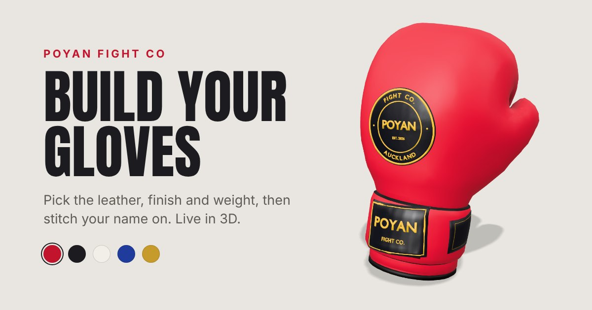
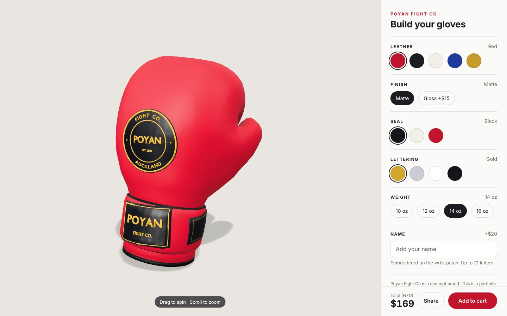
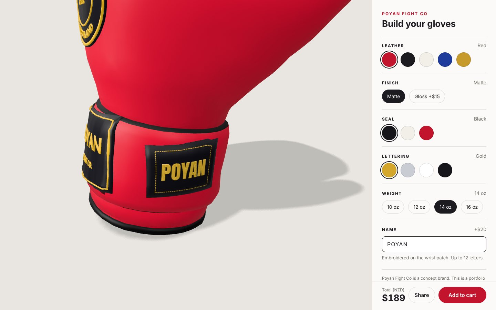
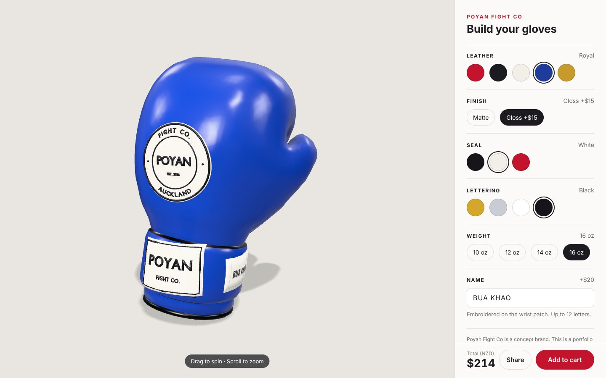
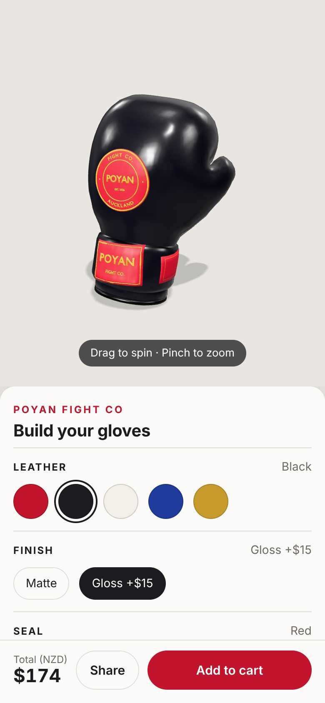

# Poyan Fight Co: 3D Glove Builder



A 3D product configurator for Muay Thai gloves. Pick the leather, finish, seal, lettering and weight, stitch your name onto the wrist patch, then share your exact build with a link.

**Live demo:** [poyan-fight-co.vercel.app](https://poyan-fight-co.vercel.app)

> Poyan Fight Co is a concept brand I made for this portfolio piece. Nothing is for sale.

---

## The idea

Fight gear is bought on looks as much as fit. Online, most stores show a few photos per colourway, and custom orders get sorted out over Instagram DMs. A configurator lets the customer see their exact glove before they buy, from every angle, and send it to a mate or a coach for a second opinion.

I built this to show what that could look like for a fightwear brand or store: fast, phone-first, and fun enough that people play with it.

## What it does

- **Live 3D glove** you can spin and zoom, with soft studio lighting and a real shadow
- **5 leather colours, 2 finishes, 3 seal colours, 4 lettering colours and 4 weights.** That's 480 combinations before you add a name.
- **Matte or gloss:** the finish actually changes how the leather reflects light
- **Weight changes the size.** A 16 oz glove is visibly bigger than a 10 oz one.
- **Custom name, embroidered** on the wrist patch as you type. The camera glides in so you can watch it appear.
- **Live price in NZD** that updates with every choice
- **Share your build:** every choice is saved in the link. On phones, Share opens the normal share menu (Messenger, WhatsApp, Instagram).
- **Works on phones:** side panel on desktop, bottom sheet on mobile
- **Loading screen, intro spin and a "drag to spin" hint**, with no spinning for people who've turned on reduced motion

| Desktop | Name patch |
| --- | --- |
|  |  |
| **Opened from a shared link** | **Phone** |
|  |  |

## How it works

### One source of truth
Every choice lives in a single typed `config` object. The panel changes it, `applyConfig()` shows it on the glove, `getPrice()` prices it, and `share.ts` writes it into the link. Adding a new colour is a one-line change in `config.ts`: its button, price and share link all follow automatically.

### Recolouring a texture that already had red baked in
The original glove texture was red, so tinting it blue gave you purple. On load, I make a greyscale copy of the texture, brightened so the leather comes out near white, and then the material colour sets the final shade. That way any colour comes out clean.

### Branding that sits flush on a curved glove
The seal, labels and name patch were made in Blender and wrapped onto the glove with raycasts: every point is projected onto the leather, then lifted just off the surface so nothing flickers or sinks in. When the name patch was moved down the cone-shaped strap, its top edge sank into the leather, so I re-projected all 85 of its points half a millimetre off the strap and checked 576 sample points across it to confirm the visible face sat clear.

### The name patch is a live canvas
The name is drawn on a hidden 2D canvas and used as the patch's texture. Thin diagonal "thread" lines are drawn only inside the letters, a soft shadow sits underneath, and a second black-and-white canvas works as a bump map so the stitching catches the light. Long names shrink to fit. The patch fabric and thread follow the seal and lettering colours, so it always matches the brand label.

### A camera that follows what you're editing
When you click into the name box, the camera glides to the wrist patch, then glides back when you're done. If you grab the glove mid-glide, it stops and gives you control. All movement is timed in seconds rather than frames, so it runs at the same speed on a 60 Hz laptop and a 120 Hz phone.

### Shareable builds that can't be broken
Choices are stored in the address bar (`?leather=royal&finish=gloss&weight=16&name=...`) without reloading the page or filling up the Back button. Links are treated as untrusted: every value is checked against the real options, unknown ones fall back to defaults, and the name is only ever shown as text.

### Performance
- **Model: 646 KB → 148 KB.** Meshopt compression for the geometry and WebP for the texture, run with one command (`npm run optimize-model`). The optimiser's default settings would have merged the colour zones and deleted the name patch's UV map, so the script switches those off.
- **JavaScript: 171 KB gzipped**, mostly Three.js
- The canvas measures itself rather than the window, and the camera distance is fitted to the narrower side of the screen, so the glove is framed properly on any shape of screen.

## Built with

- [Three.js](https://threejs.org) for the 3D
- TypeScript (strict mode) and [Vite](https://vite.dev)
- [Blender](https://www.blender.org) for the branding, labels and name patch
- [glTF Transform](https://gltf-transform.dev) for model compression
- [Vercel](https://vercel.com) for hosting

## Project structure

```
src/
  config.ts       every option, its colour and price, and the defaults
  main.ts         scene, lighting, camera, loading, and applying the config to the glove
  panel.ts        builds the options panel from config.ts
  price.ts        works out the total and formats it as NZD
  share.ts        reads and writes builds in the link, and the Share button
  name-patch.ts   draws the embroidered name onto a canvas texture
  fly.ts          smooth camera moves to a part of the glove
  style.css       layout for desktop and phone
public/
  models/glove.glb   the compressed glove model
```

## Running it locally

```bash
cd poyan-fight-co
npm install
npm run dev              # local dev server
npm run optimize-model   # compress public/models/glove.glb after a new Blender export
npm run build            # type-check and build for production
```

## What I'd add for a real store

- **Connect Add to cart** to the store's checkout (e.g. Shopify), with the build saved on the order so the workshop knows exactly what to make
- **Swap in the brand's own gloves and colours.** The options all live in one config file.
- **A preview image for each build**, so a shared link shows that exact glove
- **"View in your room" AR** on phones
- **Simple analytics** on which colour combos people build most, to inform stock and new colourways

## Credits

- 3D glove model: ["Boxing gloves"](https://sketchfab.com/3d-models/boxing-gloves-9d244a5bfaf84ea398cff99154e99eab) by [ayumi ikeda](https://sketchfab.com/rxf10240), licensed under [CC BY 4.0](https://creativecommons.org/licenses/by/4.0/). Modified with new branding, a name patch and colour options.
- Name patch font: [Anton](https://fonts.google.com/specimen/Anton), SIL Open Font License

Built by Poyan Payandeh in Auckland, New Zealand.